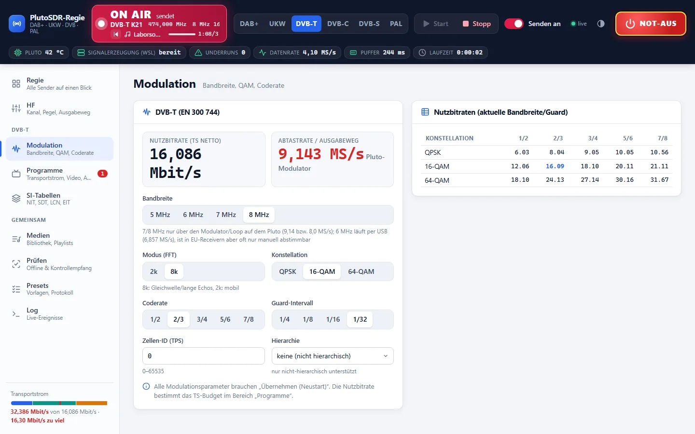
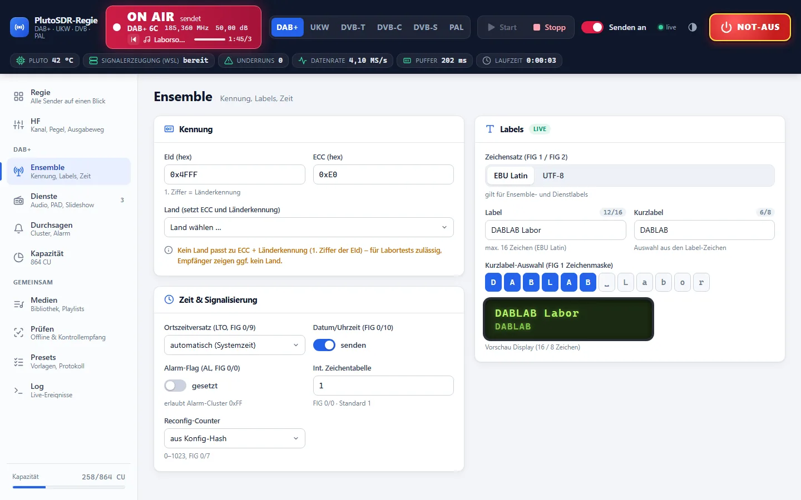
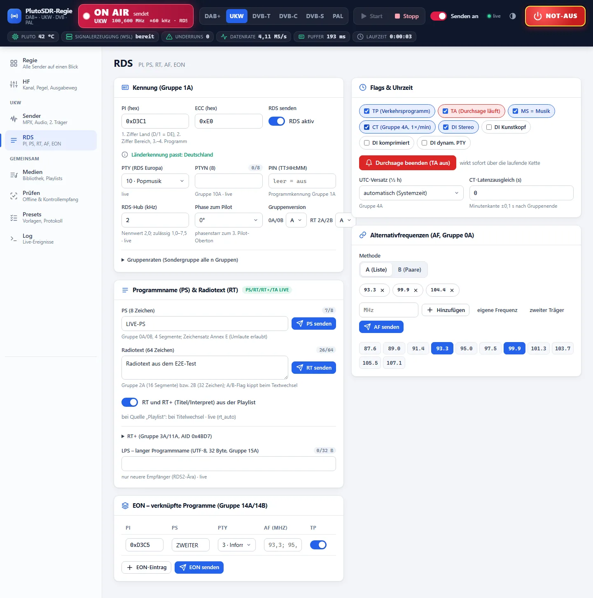
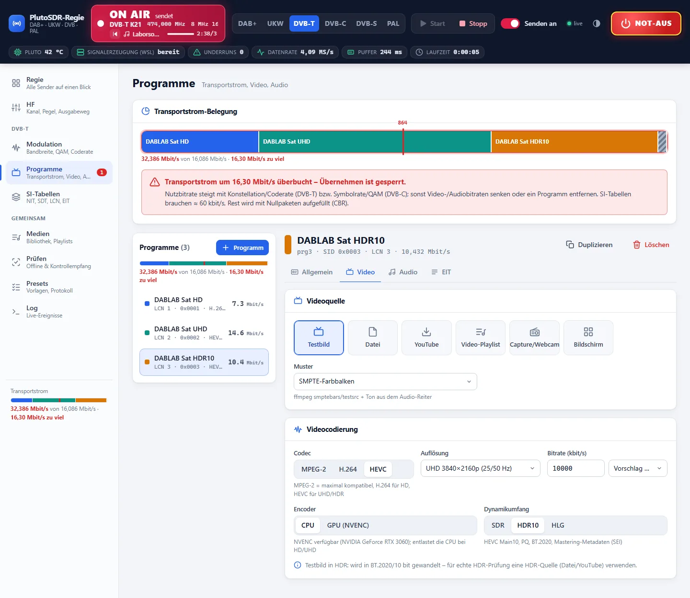
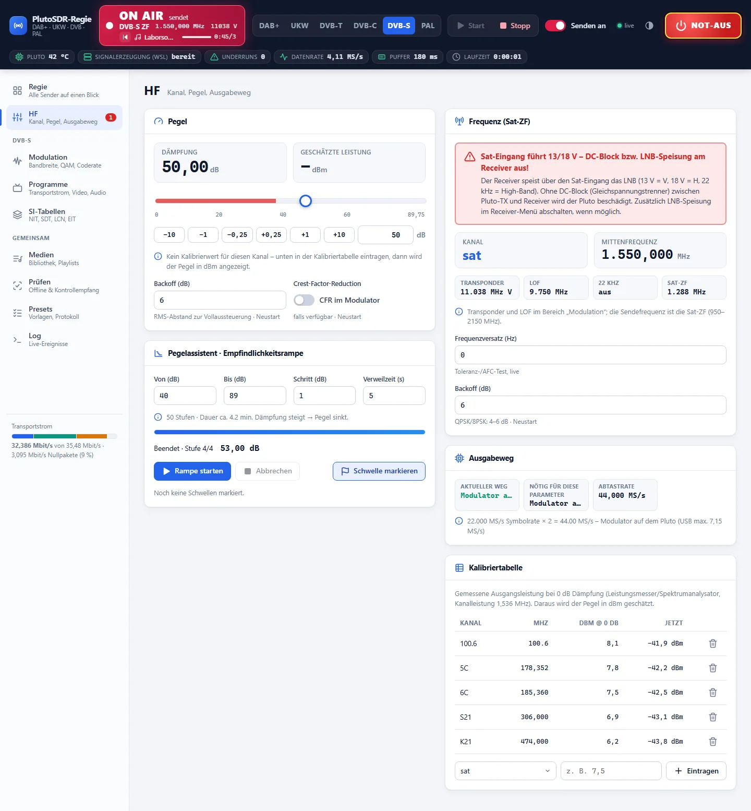
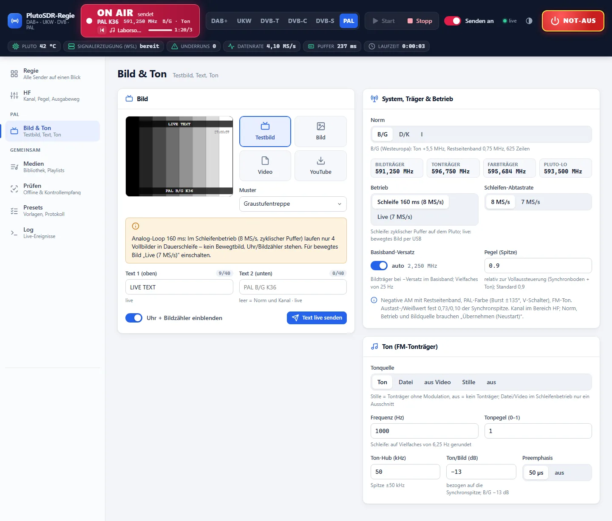
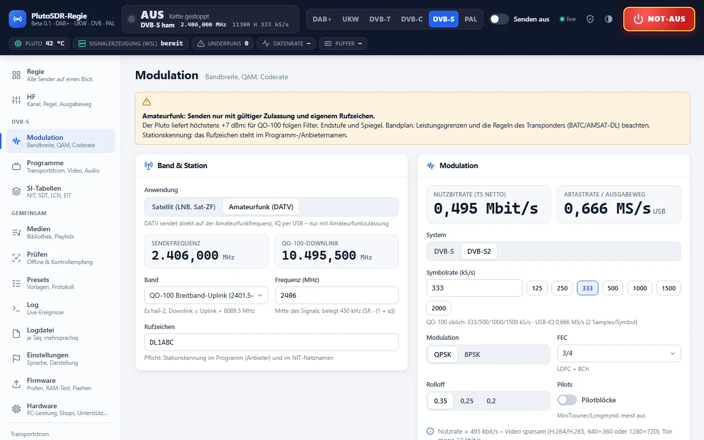
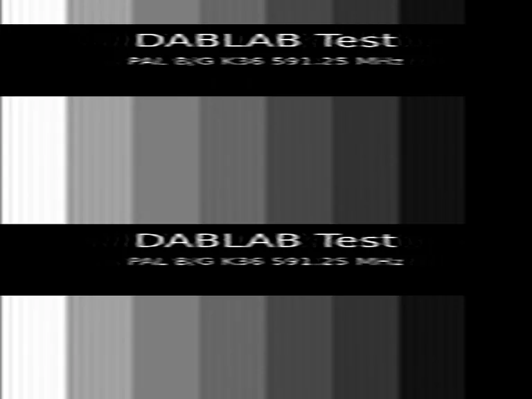

# Muxwright

**Multi-standard test transmitter for the ADALM-Pluto (PlutoSDR).** One Pluto, one dashboard: DAB+, FM with RDS,
DVB-T, DVB-C, DVB-S/S2 (SD to UHD/HDR10), analogue PAL and amateur-radio DATV for QO-100 – with a monitoring receiver
on the Pluto's own RX input, expected/actual reports and printable test records. Since Beta 0.3 also ATSC, ISDB-T/Tb,
DTMB, J.83 B/C, NTSC-M/J, PAL-M/N and RBDS; since Beta 0.4 DVB-T2 (marked *untested* until verified with real
receivers); since Beta 0.5 teletext and image-folder infoscreens; since Beta 0.6 a monitoring receiver on the Pluto's
RX path (received picture, MER, constellation), logo/text overlays, network streams (SRT/RTMP/OBS), a schedule with EIT
programme guide and experimental HbbTV signalling; since Beta 0.7 HbbTV applications in the broadcast signal itself
(DSM-CC object carousel) with a built-in TV portal, games and tools.

Website: **https://muxwright.com** · Windows installer: [request it on the website](https://muxwright.com/download.html) (e-mail confirmation and lab-only commitment required) · Status: **Beta 0.7**

This repository contains the complete source. There are no binary releases here – build it yourself (see [Running from source](#running-from-source) and [Building the installer](#building-the-installer)) or request the installer on the website.



> ⚠️ **Transmit only into a shielded setup** – by cable with an attenuator, in an RF shielding box or in a test chamber.
> Radiating broadcast standards into free space is illegal without a frequency assignment. Muxwright starts muted
> (−89.75 dB), has an emergency stop and an enforceable minimum attenuation. DATV on the amateur bands requires an
> amateur radio licence. See [Transmitting & law](https://muxwright.com/recht.html).

---

## Contents

1. [What it does](#what-it-does)
2. [How it works](#how-it-works)
3. [Standards in detail](#standards-in-detail)
4. [Hardware](#hardware)
5. [Installation](#installation)
6. [Repository layout](#repository-layout)
7. [Running from source](#running-from-source)
8. [Building the installer](#building-the-installer)
9. [API](#api)
10. [Tests](#tests)
11. [Licences and codecs](#licences-and-codecs)
12. [Credits](#credits)

---

## What it does

| | |
|---|---|
| **Many standards, one UI** | DAB/DAB+ (EN 300 401), FM stereo + RDS/RBDS (ITU-R BS.450 / IEC 62106 / NRSC-4-B), DVB-T (EN 300 744), DVB-C (EN 300 429, J.83 A/B/C), DVB-S/S2 (EN 300 421 / EN 302 307-1), PAL B/G, D/K, I, M, N and NTSC-M/J (ITU-R BT.470), ATSC 1.0 (A/53), ISDB-T/Tb (ARIB STD-B31 / ABNT NBR 15601), DTMB (GB 20600), DVB-T2 (EN 302 755) – the additions of Beta 0.3 and 0.4 are marked *untested* |
| **Amateur radio DATV** | DVB-S2 on QO-100 (2401.5–2409.5 MHz uplink) and the 13 cm, 23 cm, 70 cm and 6 cm bands, 25–3500 kS/s, callsign enforced in SI tables |
| **Monitoring receiver** | The Pluto's RX input decodes the transmitted signal: sync, SNR, services, RDS groups, PAL picture, DVB-S2 BBFRAME CRCs |
| **Expected/actual reports** | Every configuration is rendered offline, decoded and compared line by line with the settings |
| **Test records** | Print-ready record with timestamps, parameters and results; test plans for level ramps, channel changes, announcements |
| **Guided setup** | Device and firmware check, PC performance rating (CPU/NVENC), operating mode (lab / amateur radio), legal confirmations, component installation |
| **Firmware flasher** | Verifies the bundled Pluto firmware, tests it in RAM first, backs up the running firmware, flashes only after confirmation |
| **20 languages** | Dashboard, setup and website: de en fr es pt it nl pl cs sv ru uk tr ar hi zh ja ko id vi |
| **Live preview** | Every transmitted TV programme as smooth video (about 12 frames/s) decoded from the finished transport stream, next to the picture received back through the Pluto's RX path – on the Regie tile and the programme page, enlarge with a click |
| **No codecs shipped** | FFmpeg, x264/x265, ODR-mmbTools with FDK-AAC, TSDuck and welle-cli are installed by the user from the official sources (see [Licences and codecs](#licences-and-codecs)) |

### New in Beta 0.7

| Feature | Details | Verification so far |
|---|---|---|
| **HbbTV in the broadcast signal** | DSM-CC object carousel (DSI/DII/DDB, BIOP) on its own PID per TV programme, `hbbtv.transport: "carousel"`; the TV needs no internet. Module versions follow the content, so TVs never keep stale files. Available for DVB-T, DVB-T2, DVB-C (Annex A) and DVB-S/S2 | `tsp -P dsmcc` and the built-in check reassemble every file; DVB-C and DVB-S/S2 checks green; on an LG OLED (webOS 4.5) over DVB-T2 |
| **TV portal (red button)** | Built-in app: weather (Open-Meteo, MET Norway as fallback), DWD rain radar, RSS news, programme list with switching, LAN video library, picture gallery, info page, live window; app language auto/de/en | all pages on an LG OLED (webOS 4.5, Chrome 53) |
| **Games** | 10 own games (blocks, snake, 2048, pairs, …) and Freedoom (Doom engine as asm.js for TVs without WebAssembly), Freedoom loaded from the carousel in rotating portions. Freedoom is not part of the installer: build it with `hbbtv_apps/doom/build.sh` (Emscripten, WSL) into `runtime/hbbtv_apps/doom`, otherwise the tile stays hidden | all games started on the LG; Freedoom: 56 chunks in 37 s over DVB-T2; frame rate and sound not yet confirmed |
| **Tools** | 70 tools in 9 categories (transmitter & TV, time, calculators, money, RF & electronics, tables, health, lists, random & relax); number forms with OK/►/◄ editing | all 70 tools on the LG without script errors |
| **SSH terminal on the TV** | Optional terminal to LAN hosts through the PC (`pc/hbbtv_ssh.py`): pairing PIN only on the PC's localhost page, lockout after wrong PINs, targets limited to the private LAN or an allow-list | end to end on the LG to the Pluto |
| **Own HbbTV apps** | Any folder with an `index.html` (up to 4 MB) is sent and resent automatically when it changes | carousel check |

### New in Beta 0.6

| Feature | Details | Verification so far |
|---|---|---|
| **Monitoring receiver (RX picture)** | While the preview is open, the Pluto's RX path captures ~1.8 s at the TX channel (`iio_readdev`, 4 M-sample blocks), transferred over USB via a short-lived HTTP server, decoded with GNU Radio gr-dtv (DVB-T) or the DVB-C/S decoders; first keyframe per programme, RX gain tracks clipping | live on a Pluto (K21, 64-QAM 2/3): picture every ~48 s, 0 transport errors, 0 DAC underflows |
| **MER and constellation** | Equalised data cells tapped after gr-dtv's reference-signal block; robust MER estimate (DC carriers of the zero-IF receiver and outlier cells excluded and reported), constellation in the preview and the test protocol | 27.9–28.6 dB on the Pluto; 34.3 dB in the IQ loopback of the installer test |
| **Logo and text overlay** | PNG/JPG logo (position, size, opacity) and a text line or scrolling ticker per TV programme; text changeable live via `ctl` without restarting the chain; CPU encoder only | rendered and inspected frame by frame, live text change during a 60 s render |
| **Network stream source** | Pull `srt://`, `udp://`, `rtp://`, `rtmp://`, HLS; listen mode as OBS target (RTMP with stream key, SRT); feeder with fixed frame clock, fallback picture and automatic reconnect – the TS rate never changes | stream starting late, dropping and returning: PCR jitter 0, no DTS jumps; LAN/SRT listening needs the optional Windows FFmpeg |
| **Schedule** | Running order per programme by time and weekday (file, playlist, test pattern, image folder), frame-exact switching without restarting the chain, EIT present/following and EIT schedule (0x50) for 48 h | switching at the planned frame, EIT p/f within 0.6 s; *untested* on TV EPGs |
| **HbbTV signalling** | AIT (table 0x74) per programme on its own PID, PMT entry stream type 0x05 with `application_signalling_descriptor`, AUTOSTART or PRESENT | `tstables`/`tsanalyze` decode the AIT, repetition 1 s; *experimental*, *untested* on TVs |
| **Setup** | New required component GNU Radio gr-dtv (Ubuntu package); parallel compile jobs follow the free memory (8 GB PCs); Windows FFmpeg now from BtbN n8.1 (n7.1 was removed upstream) | headless installer test with WSL limited to 4 GB |

### New in Beta 0.5

| Feature | Details | Verification so far |
|---|---|---|
| **Teletext (DVB)** | EN 300 472 teletext stream (stream type 0x06, `teletext_descriptor`) in the PMT of every selected programme, ≈ 90 kbit/s; pages from the dashboard editor (40×23 with colour tags, Fastext links), from a folder of `.tti`/`.txt` files (re-read every 2 s) and an automatic index page 100; rolling clock in the header, German/English national character set | decoded with libzvbi (FFmpeg `libzvbi_teletextdec`) from the multiplexed, regulated stream incl. umlauts; *untested* on TVs |
| **Teletext (PAL)** | VBI lines 7–22 and 320–335, 6.9375 Mbit/s NRZ at 66 % white; live mode carries all pages, the 160 ms still-picture loop only the pages that fit into 128 lines (≈ 5) | IQ → synchronous demodulation → slicer → libzvbi: 128/128 lines bit-exact for the loop (FFT and stream method) and the live encoder; *untested* on TVs |
| **Image folder (infoscreen)** | Always sends the newest image of a folder (JPG/PNG/BMP/WebP, polled every 0.5 s); low-latency encoding (no B-frames/lookahead, 0.2 s mux delay, small TSDuck buffer) | new image visible in the preview after 0.9–2.6 s (measured); add the receiver's own delay |
| **Programmes without audio** | Audio codec "none": TV programme with video only, e.g. 3–4 infoscreens on one DVB-C channel | PMT and decoder check without audio stream |
| **AMD GPU encoder** | `h264_amf` / `hevc_amf` through the Windows FFmpeg, same sources as NVENC | *untested* – no AMD card in the lab, feedback welcome |

## How it works

```
┌──────────────── Windows PC ────────────────┐       USB        ┌──────── ADALM-Pluto ────────┐
│ Dashboard (browser)  ──► pc/server.py      │ ───────────────► │ iiod (IQ streaming, ≤ 7 MS/s)│  DAB+, FM, PAL,
│   HTTP API + SSE          │ pylibiio       │                  │                              │  DVB-S ≤ 6 MBd, DATV
│                           ▼                │  USB network     │ muxwright-agent :8080        │
│ WSL2 "dablab" (Ubuntu 24.04)               │ ───────────────► │   dvbt_mod / dvbc_mod /      │  DVB-T 8 MHz,
│   runner/dablab_run.py                     │  UDP TS :1234    │   dvbs_mod / dvbs2_mod       │  DVB-C, DVB-S/S2
│   ffmpeg · ODR-mmbTools · TSDuck · modulators│                │   (ARM, NEON, 2 cores)       │  ≤ 22 MBd
│   welle-cli · redsea · own RX decoders     │ ◄─────────────── │ RX (AD9364)                  │  monitoring
└────────────────────────────────────────────┘                  └──────────────────────────────┘
```

* **Two output paths.** Everything that fits through USB (DAB+ at 2.048 MS/s, FM at 4.096 MS/s, PAL, DVB-S ≤ 6 MBd,
  DATV) is modulated on the PC in WSL and streamed as IQ via libiio. The Pluto sustains only about 7 MS/s over USB,
  but 8 MHz DVB-T needs 9.143 MS/s – so DVB-T/C/S/S2 are modulated **on the Pluto's ARM** by the Muxwright firmware;
  the PC only sends the transport stream over the USB network (UDP, up to 32 Mbit/s).
* **On-device modulators** (`pluto_fw/mod`, C, MIT): fixed-point coder/interleaver/mapper, Stockham radix-4 IFFT with
  NEON, bit-identical to the C reference and to gr-dtv. 8k/64-QAM/7/8 runs at real-time factor 1.00 with 55–67 % load
  per Cortex-A9 core; DVB-S2 QPSK reaches 27 MBd on one core (limit set to 22 MBd for headroom, 8PSK 15 MBd).
* **Firmware** (`pluto_fw`): plutosdr-fw v0.31 base (Buildroot 2019.02, Linux 4.14, stock FPGA bitstream),
  libiio/iiod 0.25, real-time and DMA tuning, the modulators, `iqplay` and a small HTTP device agent. U-Boot, the
  U-Boot environment and the AD9364 unlock are never touched. The image can be booted from RAM via DFU before flashing.
* **Safety.** The server starts with −89.75 dB, `--min-atten` enforces a floor, the dashboard has one emergency stop,
  the attenuation read-back is verified every 2 s, and transmitting is refused until the setup (legal confirmations,
  operating mode) is complete. DATV is only enabled in amateur-radio mode with a callsign.

## Standards in detail

| Standard | Output path | Key parameters | Monitoring |
|---|---|---|---|
| **DAB / DAB+** | USB, 2.048 MS/s | Modes I–IV, EEP/UEP, 864 CU capacity view, DLS/DL+, MOT slideshow, announcements (clusters, alarm), TII, ECC/LTO | welle-cli: sync, SNR, FIC CRC, service labels, DLS, MOT |
| **FM + RDS** | USB, 4.096 MS/s | ±75 kHz deviation, 19 kHz pilot, 38 kHz stereo, MPX power per BS.412, RDS groups 0A/1A/2A/3A/4A/10A/11A (RT+)/14A (EON)/15A, AF methods A/B, second carrier for adjacent-channel tests | own demodulator + redsea: SINAD, channel separation, RDS error rate |
| **DVB-T** | Pluto ARM (7/8 MHz) or USB (5/6 MHz) | 2k/8k, QPSK/16/64-QAM, code rates 1/2–7/8, GI 1/4–1/32, TPS, cell ID; MPEG-2 SD and H.264 HD live, several programmes, PAT/PMT/SDT/NIT/EIT/TDT with LCN | gr-dtv receiver (bit-exact), tsanalyze |
| **DVB-C** | Pluto ARM | 16–256-QAM, symbol rate free (6.9 MBd typical), S/K cable channels, cable delivery descriptor | numpy demodulator, tsanalyze |
| **DVB-S** | Pluto ARM ≤ 22 MBd, USB ≤ 6 MBd | QPSK, FEC 1/2–7/8, RRC α = 0.35 in the AD9361 FIR or in software, satellite IF 950–2150 MHz, satellite delivery descriptor | own hard-decision receiver |
| **DVB-S2** | Pluto ARM ≤ 22 MBd (QPSK) / 15 MBd (8PSK) | QPSK 1/4–9/10, 8PSK 3/5–9/10, pilots, roll-off 0.35/0.25/0.20, CCM; HD H.264, UHD HEVC and HDR10 (HEVC Main10) in one transponder | BBFRAME CRC per packet, bit-exact against gr-dtv |
| **DATV (ham)** | USB, 2/4/8 samples per symbol | DVB-S2 at 25–3500 kS/s on QO-100 or 13/23/70/6 cm, callsign in provider name and NIT network name, band-edge check | DVB-S2 receiver |
| **PAL B/G, D/K, I** | USB | negative AM with vestigial sideband, PAL colour with burst, FM sound (+5.5/6.5/6.0 MHz), test pattern, image, video or YouTube source with clock overlay, channels E2–E12, K21–K69, S02–S41, China DS1–DS68 | own demodulator: line frequency, levels, sound/vision ratio, decoded picture |

**New in Beta 0.3 and 0.4 – not yet tested with real receivers (marked *untested* in the dashboard):**

| Standard | Output path | Key parameters | Verification so far |
|---|---|---|---|
| **DVB-T2** (0.4) | Pluto ARM, 9.143 MS/s at 8 MHz | T2-base, SISO, one PLP; 1K–32K normal/extended, QPSK–256-QAM, code rates 1/2–5/6, all guard intervals and PP1–PP8 (combinations checked against EN 302 755 Tab. 58), rotated constellations, 5–8 MHz; profile Germany 32K 64-QAM 2/3 GI 19/256 PP4 (27.3 Mbit/s) and a light profile 8K 64-QAM 3/5 (22.3 Mbit/s); NIT with T2 delivery descriptor | every stage bit-exact against gr-dtv, loopback through two independent receivers without packet errors |
| **ATSC 1.0** | Pluto ARM, 10.762 MS/s (1 sample/symbol) | 8-VSB, 19.39 Mbit/s, PSIP: MGT, TVCT (virtual channels major.minor), STT; MPEG-2 + AC-3; channels A2–A69 | symbols bit-exact against gr-dtv, loopback through gr-dtv `atsc_rx` without packet errors |
| **ISDB-T / ISDB-Tb** | Pluto ARM, 8.127 MS/s | modes 1 and 3, GI 1/4–1/32, one layer (13 segments) or 1seg + 12 segments, QPSK/16/64-QAM, time interleaving; NIT with ISDB delivery, TS information and partial-reception descriptors, 1seg PMT on 0x1FC8; Brazil (H.264, AAC LATM, A14–A69 + 1/7 MHz) and Japan (MPEG-2, AAC, J13–J62) | loopback through gr-isdbt without packet errors, TMCC decoded |
| **NTSC-M / NTSC-J, PAL-M, PAL-N** | Pluto ARM (loop) | 525/59.94 still-image loop (7.993 MS/s, 508 samples per line), NTSC burst without V switching, 7.5 IRE setup (NTSC-M), PAL-M/N subcarriers, 4.5 MHz FM sound with 75 µs pre-emphasis; channels A2–A69, Japan J1–J62 | own demodulator: line frequency, levels, decoded picture |
| **RBDS / FM regions** | USB | RBDS programme types, PI from US call signs (NRSC-4-B), no ECC; FM bands Europe, North America, Japan 76–95 MHz, China | redsea |

### Dashboard pages

| DAB+ | FM / RDS | DVB-T |
|---|---|---|
|  |  |  |

| DVB-S / S2 | PAL | DATV on QO-100 |
|---|---|---|
|  |  |  |

PAL test pattern as decoded by the Pluto's own RX input:



## Hardware

| | Minimum | Recommended |
|---|---|---|
| **SDR** | ADALM-Pluto **Rev. B** with the AD9364 unlock (70 MHz–6 GHz). Rev. C and AD9363 clones ("PlutoSDR development board", Pluto+) are untested; DAB+/FM over USB usually work, the modulator firmware has not been verified on them | original ADALM-Pluto Rev. B |
| **PC** | Windows 10 (2004+) / 11, 64-bit, WSL2 (virtualisation enabled in the BIOS), 8 GB RAM. Any 2-core CPU for DAB+/FM/SD | 6 cores / 12 threads for HD H.264 (x264), 16 cores or an NVIDIA GPU with NVENC (Turing or newer) for UHD/HDR10 |
| **Cabling** | SMA → F (satellite IF, plus a **DC block** – receivers feed 13/18 V) or SMA → IEC (DVB-T/C, FM, PAL), 20–50 dB of attenuators | RF shielding box for antenna tests |

### What you need

A PlutoSDR and a few RF parts for a cabled, shielded setup. The links below are affiliate links (Amazon, AliExpress) – they help fund
the project, the price is the same for you.

| <a href="https://muxwright.com/go/pluto"></a> | <a href="https://muxwright.com/go/pluto-ali"></a> |
|:---:|:---:|
| **PlutoSDR-compatible SDR** | **PlutoSky R2 (Zynq 7020, AD9361)** |
| 70 MHz – 6 GHz, Zynq + AD936x – a clone, not the original ADALM-Pluto Rev. B | 2T2R clone by OpenSourceSDRLab; DAB+/FM over USB usually work, the modulator firmware is untested on it |
| [View on Amazon](https://muxwright.com/go/pluto) | [View on AliExpress](https://muxwright.com/go/pluto-ali) |

The original ADALM-Pluto Rev. B (the board Muxwright is verified on) is sold by Analog Devices and its distributors.

Cabling and protection – always transmit through attenuators into the receiver or a shielded box:

| <a href="https://muxwright.com/go/att30"></a> | <a href="https://muxwright.com/go/dcblock"></a> | <a href="https://muxwright.com/go/sma"></a> | <a href="https://muxwright.com/go/satf"></a> |
|:---:|:---:|:---:|:---:|
| **Attenuator 30 dB** | **DC block** | **SMA cable** | **SMA → F adapter** |
| SMA, DC – 6 GHz; stack 20–50 dB in front of the receiver | protects the Pluto from the 13/18 V LNB feed of satellite receivers | short male–male leads | DVB-S/S2 into the satellite input |
| [View on Amazon](https://muxwright.com/go/att30) | [View on Amazon](https://muxwright.com/go/dcblock) | [View on Amazon](https://muxwright.com/go/sma) | [View on Amazon](https://muxwright.com/go/satf) |

The full list of adapters, attenuators and QO-100 gear is on the [hardware page](https://muxwright.com/#hardware).

## Installation

1. Request the installer at https://muxwright.com/download.html. You confirm your e-mail address and that you use
   Muxwright only in a shielded lab; the download link arrives by e-mail. Run `Muxwright-Setup-0.4-beta.exe`
   (no administrator rights needed; ~82 MB) and compare the SHA-256 shown on the download page.
2. Start Muxwright – a console window (the server) opens and the dashboard appears in your browser at
   `http://127.0.0.1:8792/`. Closing the console mutes the Pluto and stops the server.
3. The **guided setup** walks you through: device and firmware check → PC performance → operating mode (lab or
   amateur radio with callsign) → legal confirmations → **components**. Each component (Linux environment, FFmpeg,
   TSDuck, ODR-mmbTools, welle-cli + redsea, modulators, optional yt-dlp and a Windows FFmpeg for NVENC) shows its
   licence and source; one click per component builds it from the official sources in the WSL distribution
   `dablab`. A fresh machine takes about five minutes.
4. For DVB-T/C/S/S2 and PAL the Pluto needs the Muxwright firmware: open **Firmware**, run the **RAM test** (flash
   untouched, unplugging restores the old firmware), then **Flash** – the running firmware is backed up first and
   can be flashed back the same way.

If WSL is missing entirely, run `wsl --install --no-distribution` once as administrator and reboot; the setup
handles the rest. Useful start options: `Muxwright.exe --min-atten 40` (never louder than 40 dB attenuation),
`--lan` (dashboard reachable in your network), `--port 8792`, `--uri usb:` / `--uri ip:192.168.2.1`,
`--wsl-distro <name>`.

## Repository layout

```
pc/            Windows server: HTTP API + SSE, Pluto control (pylibiio), monitoring receivers, setup, flasher, logs
  server.py      API, configuration, TX state machine, safety logic
  pluto.py       libiio: LO, sample rate, attenuation, IQ streaming, read-back
  device.py      on-device modulators via the firmware agent and SSH
  rxdecode.py    monitoring: welle-cli, redsea, gr-dtv, PAL/DVB-S2 decoders (run in WSL)
  setup.py       component installation with per-component licence consent (runtime/components.json)
  flasher.py     firmware: image check (FIT/md5/DFU suffix), RAM boot, backup of mtd3, flash via dfu-util
  hwcheck.py     CPU/GPU/NVENC rating and benchmark
  libiio/        libiio 0.25 Windows binaries (LGPL)
  device_files/  statically linked ARM modulators deployed to the Pluto
web/           Dashboard – vanilla JS ES modules, no build step, works offline; flags/ from flag-icons (MIT)
  js/i18n/       translations (a/b/c.js for 7 languages, lang/<code>.js for 13 more; test/i18n_check.mjs)
runner/        Signal generation in WSL: dablab_run.py (live/render/check/selftest), DAB, FM, DVB, PAL
  fm/            FM/RDS DSP (GPL-3.0, see NOTICE.md)
  dvb/           TS muxing, SI tables (DVB, ISDB, ATSC PSIP), encoders (ffmpeg/NVENC), sources (files, playlists, YouTube)
  pal/           analogue TV: PAL B/G/D/K/I/M/N and NTSC-M/J loops, test patterns, check demodulator
  patches/       patches for ODR-mmbTools and welle.io applied during component installation
pluto_fw/      Firmware: build.sh (Buildroot external), br2ext/, agent/ (HTTP :8080), iqplay/, mod/ (modulators)
  mod/           dvbt_mod, dvbc_mod (Annex A/B/C), dvbs_mod, dvbs2_mod, atsc_mod, isdbt_mod, dtmb_mod, dvbt2_mod,
                 rrc_fir_gen,
                 libdvbmod; tests/ with gr-dtv, gr-isdbt and dtmb-sdr comparisons
wsl/           setup_components.sh – idempotent component installer used by the setup
launcher/      PyInstaller launcher (Muxwright.exe); Python, numpy, scipy and pylibiio are bundled, pc/ is loaded at run time
test/          Playwright UI tests against the mock server, installer end-to-end test, muted device-chain test, i18n checks
```

The Windows installer itself (Inno Setup script, licence texts) lives in the separate `installer/` folder next to this
repository; the website in `website/`.

## Running from source

```bat
:: Windows, Python 3.11+ with numpy, scipy, pylibiio, paramiko
cd pc
python server.py --min-atten 40
:: dashboard: http://127.0.0.1:8792/
```

The server expects the WSL distribution `dablab` (Ubuntu 24.04). Create it with the dashboard's setup, or by hand:

```bat
wsl --install Ubuntu-24.04 --name dablab --no-launch
wsl -d dablab -u root -- bash /mnt/<drive>/.../wsl/setup_components.sh /mnt/<drive>/.../dablab base
wsl -d dablab -u root -- bash .../setup_components.sh ... ffmpeg tsduck odr welle modulators
```

Firmware: `pluto_fw/README.md` describes the Buildroot build (about 25 minutes with 8 cores), RAM boot via DFU
(`boot_ram.cmd`) and recovery. Modulators alone: `cd pluto_fw/mod && make` (x86 self-test) or
`tests/pluto/build_s2.sh` for the ARM binaries.

## Building the installer

```bat
:: 1. launcher (PyInstaller; bundles Python, numpy, scipy, pylibiio, paramiko)
cd launcher
python -m PyInstaller --noconfirm --clean build\DABLab.spec
:: 2. Inno Setup script (installer/muxwright.iss, next to this repository) – needs Inno Setup 6 (winget: JRSoftware.InnoSetup)
::    and the firmware image pluto_fw/out/build3/pluto.frm from the firmware build (pluto_fw/README.md)
python ..\installeruild.py
```

`test/installer_e2e.py` installs the result silently into a scratch folder, creates a fresh WSL distribution, runs the
whole guided setup with Playwright and checks self-test, renders and DAB monitoring – without touching a real Pluto.

## API

The dashboard talks to `pc/server.py` over plain JSON; everything it does you can script.

| Endpoint | Purpose |
|---|---|
| `GET /api/state` | complete state: configuration, Pluto, TX, runner, onboarding |
| `PUT /api/config` | validated configuration (standard, services/programmes, SI tables, RF) |
| `POST /api/rf` | channel, frequency, attenuation, `enabled` (refused without completed setup) |
| `POST /api/tx/start` · `/api/tx/stop` | chain control; the emergency stop calls `/api/tx/stop` (mute first, then stop the chain) |
| `GET /api/events` | server-sent events: state, log, TX statistics |
| `POST /api/check` | offline render + decode, expected/actual report |
| `GET/POST /api/onboarding` | setup state, confirmations, operating mode |
| `GET /api/setup` · `POST /api/setup/install` | components, licence-confirmed installation |
| `GET/POST /api/firmware` | images, RAM test, backup, flash |
| `GET /api/hwcheck[?bench=1]` · `GET /api/logs` · `GET /api/shop` | PC rating, daily log files, hardware links |

`SPEC.md` is the binding description of the configuration schema and the interfaces between server, runner and
firmware agent.

## Tests

```bat
python test/test_ui_mock.py            :: Playwright run of the whole dashboard against test/mock_server.py (German UI)
node test/i18n_check.mjs               :: every T('…') text present in all 20 languages, placeholders intact
python pc/test_flasher_offline.py      :: flasher with fake dfu-util and fake SSH
python pc/test_api_offline.py         :: server validation incl. every standard (channel plans, rates, output path)
python test/installer_e2e.py --setup Muxwright-Setup-0.4-beta.exe
                                       :: silent install, fresh WSL distro, full setup via Playwright, self-test,
                                       :: DAB/DVB-T/FM renders, DAB monitoring, ATSC/ISDB-Tb/DTMB/J.83 B/NTSC checks
python test/e2e_device_world.py        :: device chain with a real Pluto but MUTED (-89.75 dB, transmitter off):
                                       :: server -> runner -> UDP -> modulator for ATSC, ISDB-T, DTMB, DVB-T2, J.83 B,
                                       :: DVB-C, DVB-T, DVB-S2; checks UDP delivery, DAC underflows, stuffing
```

Modulator verification (`pluto_fw/mod/tests/`):

| Modulator | Reference |
|---|---|
| DVB-T, DVB-S2 | bit-exact against GNU Radio gr-dtv |
| ATSC 1.0 | symbols bit-exact against gr-dtv, loopback through gr-dtv `atsc_rx` |
| ISDB-T / ISDB-Tb | loopback through the independent receiver [gr-isdbt](https://github.com/git-artes/gr-isdbt) |
| DTMB | loopback through the independent receiver [dtmb-sdr](https://github.com/ningzichun/dtmb-sdr) |
| DVB-T2 | every stage (BBFRAME to IQ) against gr-dtv; loopback through [sdr_receiver_dvb_t2](https://github.com/Oleg-Malyutin/sdr_receiver_dvb_t2) and [DecDVB-T](https://github.com/CasualArclamp/DecDVB-T) |
| J.83 B | QAM symbols identical to the gr-dtv J.83 B transmitter, own trellis/RS receiver |
| DVB-C (Annex A/C), PAL, NTSC, FM | numpy demodulator and the project's own decoders |

All modulators run in real time on the Pluto's two Cortex-A9 cores; the new ones were checked at the DAC with the
transmitter muted (0 underflows). None of the Beta 0.3 and 0.4 additions has been verified with a consumer receiver yet.

## Licences and codecs

* **Muxwright code** – MIT (`LICENSE`): server, dashboard, runner, modulators, firmware additions, flasher.
* **`runner/fm`** (FM/RDS) – **GPL-3.0**, because it was written after PiFmRds, PiFmAdv, MiniRDS and gr-rds
  (`runner/fm/NOTICE.md`).
* **Pluto firmware image** – built from plutosdr-fw v0.31 (GPL-2.0 and others). The build recipe and all changes are in
  `pluto_fw/`; `THIRD_PARTY.txt` contains the written source offer required by the GPL.
* **Bundled binaries** – libiio/libusb (LGPL-2.1), dfu-util (GPL-2.0), Python/numpy/scipy/paramiko in the launcher.
* **Not bundled, installed by the user:** FFmpeg with x264/x265 (LGPL/GPL), ODR-mmbTools (GPL-3.0) with FDK-AAC
  (Fraunhofer licence, no patent licence), TSDuck (BSD-2), welle-cli (GPL-2.0), redsea (MIT), yt-dlp (Unlicense).
  H.264, HEVC and AAC are patent-encumbered. Private, non-commercial use is patent-free in Germany (§ 11 No. 1 PatG);
  commercial users obtain licences from the pools (Via LA, Access Advance, Sisvel) themselves. Muxwright therefore
  ships no codecs and asks for a per-component confirmation before building them.

## Credits

Muxwright stands on the shoulders of many projects – the full list with links is in the setup wizard and at
[muxwright.com/danke.html](https://muxwright.com/danke.html). In particular: **Evariste Courjaud, F5OEO** (PlutoDVB2,
libdvbmod, dvbsdr – the proof that DATV on the Pluto works), **Charles Brain, G4GUO**, the **BATC**, **AMSAT-DL**,
**Ron Economos, W6RZ** (dtv-utils, gr-dtv), **Oleg Malyutin** (sdr_receiver_dvb_t2), **Christophe Jacquet** (PiFmRds), **Anthony96922** (MiniRDS),
**Bastian Bloessl** (gr-rds), **Opendigitalradio** (ODR-mmbTools), **Thierry Lelégard** (TSDuck),
**Albrecht Lohöfener** (welle.io), **Oona Räisänen, OH2EIQ** (redsea), **Analog Devices** (plutosdr-fw, libiio),
Buildroot, Bootlin, FFmpeg, BtbN and the GNU Radio project.

---

*ADALM-PLUTO, PlutoSDR and Analog Devices are trademarks of Analog Devices, Inc. Muxwright is an independent project
and is not affiliated with Analog Devices.*
